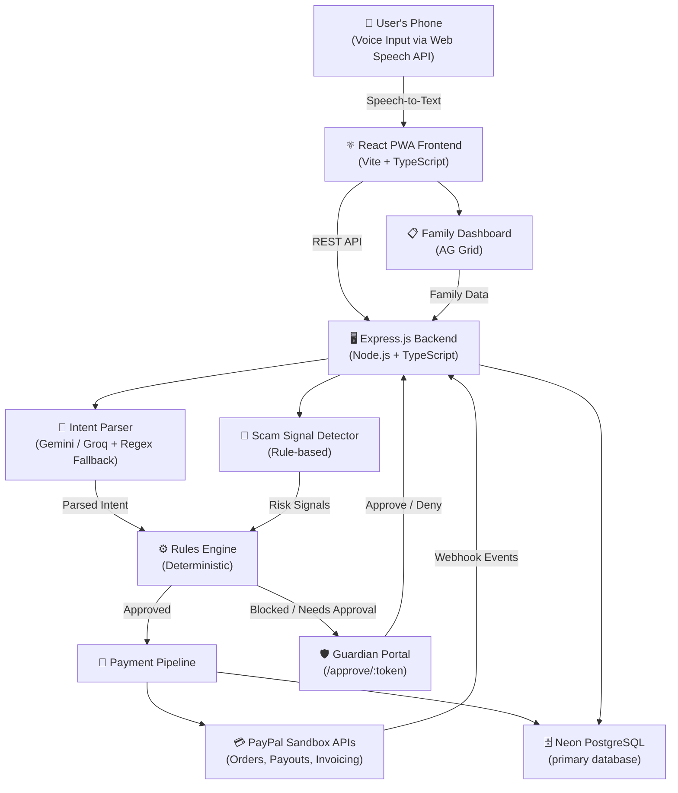

# 🔊 Awaaz Pay

**A voice-first wallet for blind and low-literacy users in India.**

> Built for the PayPal AI Hackathon

[](LICENSE)

---

## The Problem

**350 million+ adults in India are illiterate or barely literate.** Standard UPI and banking apps rely on complex text-based UIs — small fonts, nested menus, English-heavy interfaces — that exclude the people who need digital payments the most.

**Awaaz Pay replaces the text UI with conversational Hindi/English voice.** Users simply talk to make payments, check balances, and manage money. No reading required. No typing required. Just speak.

---

## Features

- 🎙️ **Voice-first interface** in Hindi, Hinglish, and English (Web Speech API)
- 🧠 **Natural language intent parsing** (Gemini 1.5 Flash + Groq Llama 3 fallback)
- 🔒 **Deterministic rules engine** — the LLM never moves money
- 🛡️ **Multi-tier trust model**
  - **Tier 1:** Trusted contacts (pre-approved, instant payments)
  - **Tier 2:** Verified merchants (standard verification)
  - **Tier 3:** New/unknown payees (requires guardian approval)
- 🚨 **Anti-scam safety interview** with real-time signal detection
- 🔑 **WebAuthn passkey biometric login** with voice-guided setup
- 🗣️ **Voice challenge** (secondary risk signal only, not a hard lock)
- 💳 **PayPal sandbox integration** (Orders API, Payouts API, Invoicing/QR)
- 📷 **Merchant QR scanning** with BarcodeDetector + jsQR fallback and spoken guidance
- 👨‍👩‍👧 **Guardian-assisted onboarding wizard**
- ⏳ **Contact cooling-off period** (24h, configurable)
- ✅ **Guardian approval workflow** with one-tap approve/deny
- 📊 **Balance check, 7-day history summary, payment explanation** — all spoken, all from code-computed facts (LLM never invents numbers)
- 📋 **AG Grid Community family dashboard** with risk-highlighted rows
- 📡 **Offline detection** with spoken alerts
- 📱 **PWA-ready** (Vite PWA plugin)

---

## Architecture



---

## Tech Stack

| Layer | Technologies |
|-------|-------------|
| **Backend** | Node.js, Express, TypeScript, Neon PostgreSQL, Zod, Vitest |
| **Frontend** | React 18, Vite, TypeScript, AG Grid Community, jsQR, @simplewebauthn/browser |
| **Payments** | PayPal Sandbox (Orders API, Payouts API, Invoicing QR, Webhooks) |
| **AI / LLM** | Google Gemini 1.5 Flash (primary), Groq Llama 3 (fallback), deterministic regex fallback |
| **Safety** | Rule-based scam phrase detection, multi-tier trust model, anti-salami-slicing velocity checks |

---

## Prerequisites

- **Node.js** >= 18
- **npm** >= 9
- A **PayPal Developer** sandbox account — [developer.paypal.com/dashboard](https://developer.paypal.com/dashboard)
- A **Google AI Studio** API key for Gemini — [aistudio.google.com/apikey](https://aistudio.google.com/apikey)
- *(Optional)* A **Groq** API key for fallback LLM — [console.groq.com](https://console.groq.com)

---

## Setup and Run

```bash
git clone https://github.com/Vansh98789/Awaaz-Pay.git
cd Awaaz-Pay
cp .env.example .env
# Fill in your PayPal sandbox and Gemini API keys in .env
npm install
npm run demo:reset    # Seeds database and LLM cache for demo
npm run dev           # Starts backend (port 3001) and frontend (port 5173)
```

---

## Environment Variables

Create a `.env` file from `.env.example` and fill in the values:

| Variable | Description | Example |
|----------|-------------|---------|
| `PORT` | Backend server port | `3001` |
| `NODE_ENV` | Environment mode | `development` |
| `PUBLIC_BASE_URL` | Public URL for the backend | `http://localhost:3001` |
| `PAYPAL_CLIENT_ID` | PayPal sandbox REST app Client ID | *(from PayPal dashboard)* |
| `PAYPAL_CLIENT_SECRET` | PayPal sandbox REST app Secret | *(from PayPal dashboard)* |
| `PAYPAL_BASE_URL` | PayPal sandbox base URL | `https://www.sandbox.paypal.com` |
| `PAYPAL_API_BASE` | PayPal sandbox API base URL | `https://api-m.sandbox.paypal.com` |
| `PAYPAL_WEBHOOK_ID` | PayPal webhook ID for event verification | *(from PayPal dashboard)* |
| `PAYPAL_SANDBOX_MERCHANT_EMAIL` | Sandbox merchant account email | *(sandbox personal account)* |
| `PAYPAL_SANDBOX_RECEIVER_EMAIL` | Sandbox receiver account email | *(sandbox personal account)* |
| `GEMINI_API_KEY` | Google AI Studio API key | *(from AI Studio)* |
| `GEMINI_MODEL` | Gemini model identifier | `gemini-1.5-flash` |
| `GROQ_API_KEY` | Groq API key (optional fallback) | *(from Groq console)* |
| `GROQ_MODEL` | Groq model identifier | `llama3-70b-8192` |
| `LLM_DEMO_CACHE` | Use cached LLM responses for demo | `true` |
| `DEMO_SKIP_COOLING` | Skip contact cooling-off period in demo | `true` |
| `DEMO_AUTH_BYPASS` | Bypass WebAuthn authentication in demo | `true` |
| `CONTACT_COOLING_OFF_HOURS` | Hours before a new contact becomes trusted | `24` |
| `DATABASE_URL` | Neon PostgreSQL connection string | Required |

---

## PayPal Sandbox Account Setup

1. Go to [developer.paypal.com/dashboard](https://developer.paypal.com/dashboard)
2. Create a **sandbox REST API app**
3. Copy the **Client ID** and **Secret** into your `.env` file
4. Create **2 sandbox personal accounts** (one for the merchant, one for the receiver)
5. Set their emails in `PAYPAL_SANDBOX_MERCHANT_EMAIL` and `PAYPAL_SANDBOX_RECEIVER_EMAIL`

---

## Test Credentials (Demo Mode)

| Role | Name | User ID | Notes |
|------|------|---------|-------|
| **Demo User** | Meena | `user_meena` | Language: Hindi |
| **Guardian** | Ramesh | `guardian_ramesh` | Approves Tier 3 payments |
| **Trusted Contact** | Bhaiya | — | Tier 1 |
| **Trusted Contact** | Sabzi wala | — | Tier 1 |
| **Merchant** | Ravi Cabs | — | Tier 2 |

**Starting Balance:** ₹2,300

> **For offline demos**, set these environment variables:
> ```
> DEMO_AUTH_BYPASS=true
> DEMO_SKIP_COOLING=true
> LLM_DEMO_CACHE=true
> ```

---

## Running Tests

```bash
npm test                          # Runs all server (180 tests) and web (12 tests) tests
npm test --workspace=server       # Server tests only
npm test --workspace=web          # Web tests only
```

---

## Known Limitations

- **Sandbox only** — All PayPal transactions use the sandbox environment; no real money is moved.
- **Custodial simulation** — The wallet ledger is a simulated internal balance, not a real custodial wallet.
- **Voice is a secondary signal** — Voice challenge is used only as a risk signal, never as the sole authentication factor.
- **The app cannot hear scam calls** — Scam detection works only on text the user speaks into the app. It cannot intercept or listen to external phone calls.
- **Browser support** — Web Speech API requires Chrome or Edge for speech recognition.
- **LLM dependency** — Without API keys or demo cache, intent parsing falls back to regex patterns which handle common phrases but not all natural language variations.

---

## How We Built It

We used AI coding tools (Google Gemini, Claude) extensively for code generation, debugging, and accelerating development. The system architecture, safety model, multi-tier trust design, rules engine logic, and all product decisions were designed and validated by the developer (Vansh Maheshwari). Every test was reviewed, every PayPal integration was manually verified against the sandbox, and the scam detection rules were hand-crafted from real-world Indian financial fraud patterns. The LLM is deliberately constrained — it parses intent and generates spoken responses but is never allowed to move money or invent financial figures. All financial computations are deterministic and code-driven.

---

## License

MIT — see [LICENSE](LICENSE) file.
