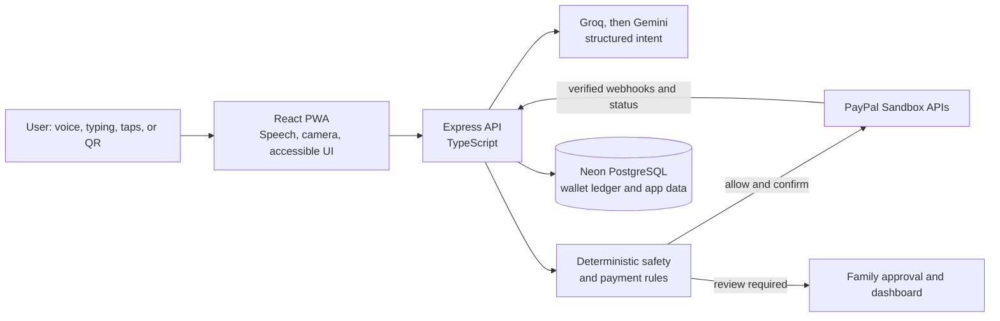

# Awaaz Pay

### A voice-first wallet designed to make digital payments easier to understand and safer to navigate.

Awaaz Pay helps blind, low-vision, low-literacy, and first-time digital payment users interact with a wallet through spoken instructions, clear readbacks, and large, high-contrast controls. Users can speak naturally in English, Hindi, or Hinglish, review payment details, and ask family to approve payments to new recipients.

**Built for the PayPal AI Hackathon.** PayPal Sandbox handles payment flows; AI helps interpret spoken intent. A deterministic rules engine controls payment decisions. The project is a prototype: it does not move real money.

---

## Why Awaaz Pay

Many wallet experiences assume users can comfortably read small text, navigate dense screens, and interpret payment details without help. Awaaz Pay makes voice the primary way to interact, while keeping visible controls available for people who prefer to tap or type.

Its central design idea is simple: **the app should explain what it understood, apply safety rules, and ask for confirmation before a payment proceeds.**

## What you can do

- **Talk to the wallet:** ask to check the wallet balance, review activity, navigate, or start a payment in English, Hindi, or Hinglish.
- **Pay by voice:** name a saved contact and amount. Awaaz Pay reads back the payment and asks for confirmation.
- **Pay by QR or PayPal Sandbox email:** choose a QR scan or enter a recipient email. Email payments to new personal recipients are sent to the family approval flow; submitting the request does not itself send money.
- **Review and approve carefully:** payment details are shown and spoken before a confirmed payment can proceed.
- **Use family safeguards:** new recipients, unusual activity, spending limits, rapid payments, and detected scam risk can require family review or block a payment.
- **Use the family dashboard:** review activity in a searchable, filterable AG Grid table with status and risk indicators; manage approval requests and contacts.
- **Create and scan merchant QR codes:** the merchant view supports PayPal invoice QR creation where available and an Awaaz Pay QR fallback for the sandbox demo.
- **Use accessible interaction options:** large touch targets, high-contrast themes, text paired with speech, keyboard-friendly controls, live announcements, speech-speed settings, and an audio cue when the microphone starts listening.
- **Install as a PWA:** use the web app on a supported device and browser.

## How a payment is protected

1. The user speaks or enters the recipient and amount.
2. The app resolves the recipient and gathers relevant payment and risk context.
3. AI may interpret the user's language into a structured intent. It does not authorize or execute a transfer.
4. The deterministic rules engine checks recipient status, spending limits, payment velocity, unusual amounts, and scam signals.
5. Awaaz Pay explains the proposed payment and asks for confirmation. Payments that require family review are held for approval.
6. Only an allowed and confirmed payment reaches the PayPal Sandbox payout flow. The result is recorded in the wallet ledger.

High scam risk or a blocked recipient can stop a payment. First-time personal recipients require family approval. Other conditions—such as an over-limit or unusual payment—can also require approval. A timeout or unclear result should be checked in Recent Activity before retrying.

## PayPal and AI integrations

### PayPal Developer Platform

The server integrates PayPal Sandbox APIs for:

- **Payouts API** to send sandbox payouts and retrieve payout batch status.
- **Orders API** to create and capture wallet-funding orders.
- **Invoicing API** to create/send invoices, generate invoice QR codes, retrieve invoice details, and record invoice payment where supported.
- **Webhooks** to verify PayPal webhook signatures and process supported events such as completed captures.
- **Reporting Balances API** to read the PayPal sandbox account balance where configured.

The balance displayed in the wallet comes from Awaaz Pay's own ledger; it is not a live balance read from PayPal. The prototype uses Sandbox accounts and does not move real funds. PayPal invoice detail access can depend on which account created the invoice, so the demo also supports a locally registered Awaaz Pay QR fallback. See [PayPal integration notes](docs/PAYPAL_NOTES.md).

### AI and speech

- **Groq** is tried first for structured intent interpretation when configured; **Google Gemini** is the fallback provider. Provider model names are configured with `GROQ_MODEL` and `GEMINI_MODEL`.
- The browser's **Web Speech API** provides speech recognition and speech synthesis. The app also supports typed input and visible controls.
- AI produces structured interpretations and analysis. Application code validates requests and applies deterministic safety rules; AI does not call PayPal or move money.

During development, **Claude and OpenAI Codex** were used as coding assistants for implementation, debugging, and refinement. They are not runtime dependencies of the deployed app.

## Architecture



## Technology

| Area | Tools |
| --- | --- |
| Web app | React 18, TypeScript, Vite, PWA plugin |
| API | Node.js, Express, TypeScript, Zod |
| Database | Neon Serverless PostgreSQL |
| Family activity grid | AG Grid Community for React |
| Speech and QR | Browser Web Speech API, camera APIs, `jsQR` fallback |
| Authentication | WebAuthn/passkeys for the standard sign-in flow; separate family dashboard login |
| Payments | PayPal Sandbox Orders, Payouts, Invoicing, Reporting Balances, and verified webhooks |
| AI | Groq with Gemini fallback for structured language interpretation |
| Hosting | Render configuration is included in `render.yaml` |

## Run locally

### Requirements

- Node.js 20 or newer and npm
- A Neon PostgreSQL database
- PayPal Developer Sandbox REST app credentials
- At least one AI provider key (Groq or Gemini) for model-backed intent parsing
- A modern browser with Web Speech and camera support for voice and QR features; Chrome or Edge is recommended

### Install

```bash
git clone https://github.com/Vansh98789/Awaaz-Pay.git
cd Awaaz-Pay
npm install
```

Copy `.env.example` to `.env`, then set the required database and service credentials. Never commit `.env` or production secrets.

```bash
npm run seed
npm run dev
```

The development scripts start the API on port `3001` and the Vite app on port `5173` by default. Open `http://localhost:5173`. The family dashboard is available at `/family`; the merchant demo is available at `/merchant`.

To create production bundles:

```bash
npm run build
```

## Configuration

The full template and comments are in [`.env.example`](.env.example). Core settings:

| Variable | Purpose |
| --- | --- |
| `DATABASE_URL` | Neon PostgreSQL connection string; required |
| `PAYPAL_CLIENT_ID`, `PAYPAL_CLIENT_SECRET` | PayPal Sandbox REST app credentials |
| `PAYPAL_API_BASE`, `PAYPAL_BASE_URL` | PayPal API endpoints; use Sandbox endpoints for this prototype |
| `PAYPAL_WEBHOOK_ID` | Webhook ID used for signature verification |
| `GROQ_API_KEY`, `GROQ_MODEL` | Primary configured AI provider |
| `GEMINI_API_KEY`, `GEMINI_MODEL` | Fallback AI provider |
| `FAMILY_DASHBOARD_EMAIL`, `FAMILY_DASHBOARD_PASSWORD` | Separate family dashboard credentials |
| `PUBLIC_BASE_URL` | Public API origin used for externally reachable callbacks and links |
| `PROTOTYPE_MODE` | Enables the shared demo wallet behavior used by the hosted prototype; Sandbox-only |

`DEMO_AUTH_BYPASS`, `DEMO_SKIP_COOLING`, and `LLM_DEMO_CACHE` are local demo switches. Production startup rejects these unsafe demo shortcuts when enabled. Do not enable them for a public deployment.

## Accessibility and current limits

Awaaz Pay is designed around voice interaction, with large controls, visible text, speech feedback, high contrast, keyboard interaction, and screen-reader announcements. Browser speech recognition quality depends on the browser, microphone, language, accent, and surroundings. Email addresses and other critical details should be reviewed before submission.

The app has not been formally validated with blind or low-vision participants, and the repository's TalkBack/VoiceOver checklist is not marked complete. Treat accessibility as an active design goal, not a claim of certification. Screen-reader behavior and speech features can vary by browser and device; Chrome or Edge is recommended for the voice demo.

Other prototype limits:

- **Sandbox only:** no real money is transferred and the wallet balance is an application ledger simulation.
- **No call interception:** scam checks use what the user says to the app and application context; the app cannot listen to external calls.
- **AI availability:** if configured AI providers are unavailable, intent parsing may use deterministic fallback patterns with narrower language coverage.
- **Invoice access:** PayPal invoice retrieval can be restricted to the account that created the invoice; the demo's local invoice registry and Awaaz Pay QR fallback address that flow for the prototype.

## Project resources

- [PayPal integration notes](docs/PAYPAL_NOTES.md)
- [Safety and payment rules](docs/RULES.md)
- [Design system](docs/DESIGN_SYSTEM.md)
- [Postman collection](docs/postman_collection.json)

## License

This project is released under the [MIT License](LICENSE).

---

## Try Awaaz Pay

- [Open the live prototype](https://awaaz-pay-l7xv.onrender.com/)
- [View the source code on GitHub](https://github.com/Vansh98789/Awaaz-Pay)
- [Watch the project demo](https://youtu.be/fzFZ9h1mRKo?si=cYwxPxjm3ZasBeJr)
