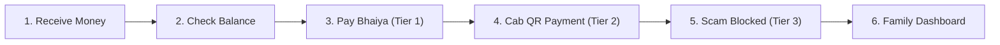

# Awaaz Pay — End-to-End Demo Script & Guide

This document contains the step-by-step scenario and exact spoken phrases to run a flawless 3-to-5 minute live demonstration or video recording of Awaaz Pay.

---

## 1. Demo Environment Flags

Set these flags in your `.env` file before running the demo:

| Variable | Recommended Demo Value | Description |
| :--- | :--- | :--- |
| `DEMO_AUTH_BYPASS` | `true` | Bypasses passkey requirement on API requests for uninterrupted live demos without physical biometric sensor setup. (Set to `false` when demonstrating WebAuthn registration/login). |
| `DEMO_SKIP_COOLING` | `true` | Bypasses the 24-hour cooling-off delay for newly added contacts, activating them immediately for instant payment demos. |
| `LLM_DEMO_CACHE` | `true` | Uses the pre-recorded `llm_demo_cache.json` for deterministic, sub-millisecond responses without external API latency or quota limits. |

---

## 2. One-Command Demo Reset

Before starting your recording or demo session, run:

```bash
npm run demo:reset
```

This cleans the SQLite database and seeds it with a known, predictable demo state:
- **User**: Meena (`user_meena`, Hindi preferred)
- **Guardian**: Ramesh (`guardian_ramesh`)
- **Pre-configured Trusted Contacts**:
  - Bhaiya (`contact_bhaiya` -> `bhaiya-sandbox@example.com`, active)
  - Sabzi wala (`contact_sabzi_wala` -> `sabzi-sandbox@example.com`, active)
- **Pre-configured Verified Merchant**: Ravi Cabs (`merchant_ravi_cabs`)
- **Initial Wallet Balance**: ₹2,300
- **Pre-warmed LLM Cache**: Loaded in `llm_demo_cache.json`

---

## 3. Starting the Application

In your terminal:

```bash
npm run dev
```

- **User Wallet Web App**: [http://localhost:5173](http://localhost:5173)
- **Merchant Demo Terminal**: [http://localhost:5173/merchant](http://localhost:5173/merchant)
- **Family Activity Dashboard**: [http://localhost:5173/family](http://localhost:5173/family)
- **Backend API**: [http://localhost:3001](http://localhost:3001)

---

## 4. The 6-Step Demo Scenario

Follow these steps in order.



---

### Step 1: Receive Money
*Goal: Show money arriving in the wallet and audio notification.*

1. Open [http://localhost:5173](http://localhost:5173).
2. The user has ₹2,300 in opening balance (funded from guardian Ramesh).
3. (Optional sandbox receive): In a second tab, trigger `/api/receive/create-order` or review initial incoming balance of ₹2,500 from Ramesh in history.

---

### Step 2: Check Balance
*Goal: Demonstrate zero-hallucination deterministic voice balance lookup from the ledger.*

1. On [http://localhost:5173](http://localhost:5173), tap the **Giant Central Mic Button** (or press Spacebar).
2. **Exact phrase to speak:**
   > *"Mera balance kitna hai"*
   > *(or in English: "Check balance")*
3. **What Awaaz Pay speaks and displays:**
   > *"Aapke khate mein 2,300 rupaye hain."*
   > *(or in English: "You have 2,300 rupees.")*

---

### Step 3: Pay Bhaiya (Tier 1 Trusted Contact)
*Goal: Demonstrate natural voice intent parsing, trust tiers, spoken readback, and mandatory confirmation before moving money.*

1. Tap the **Giant Central Mic Button**.
2. **Exact phrase to speak:**
   > *"Bhaiya ko 300 rupaye bhejo"*
   > *(or in English: "Send 300 rupees to Bhaiya")*
3. **What Awaaz Pay speaks:**
   > *"Bhaiya ko 300 rupaye bhejne hain. Kya main bhej doon?"*
   > *(or in English: "Sending 300 rupees to Bhaiya. Shall I proceed?")*
4. Tap the mic button again (or speak immediately if listening):
5. **Exact phrase to speak:**
   > *"Haan bhej do"*
   > *(or simply: "Haan" / "Yes")*
6. **What Awaaz Pay speaks and displays:**
   > *"Payment safal raha! Bhaiya ko 300 rupaye bhej diye gaye hain. Aapka naya balance 2,000 rupaye hai."*
   - PayPal Sandbox payout executes and is logged in the ledger.

---

### Step 4: Cab QR Payment (Tier 2 Merchant Flow)
*Goal: Demonstrate invoice QR code camera scanner, spoken audio guidance, and PayPal sandbox merchant payment.*

1. Open a second browser window or phone at [http://localhost:5173/merchant](http://localhost:5173/merchant).
   - Notice the demo invoice for **Ravi Cabs** with amount **₹250** and the prominent PayPal QR code.
2. In the user app ([http://localhost:5173](http://localhost:5173)), click **"📷 Scan Invoice QR"** (or press `C`).
3. Point your camera at the Ravi Cabs QR code (or use the simulated QR payload `https://awaazpay.local/invoice/INV2-DEMO-RAVI-250`).
4. **What Awaaz Pay speaks:**
   > *"Ravi Cabs, 250 rupaye. Kya main payment kar doon?"*
   > *(or in English: "Ravi Cabs, 250 rupees. Shall I pay?")*
5. Tap the mic and speak:
   > *"Haan"*
6. **Result:**
   - The payment completes.
   - On the Merchant screen ([http://localhost:5173/merchant](http://localhost:5173/merchant)), the status live-updates from **UNPAID** to **PAID** with a green badge.
   - User app speaks: *"Ravi Cabs ko 250 rupaye ka payment ho gaya hai."*

---

### Step 5: Scam Attempt Blocked (Safety Interruption)
*Goal: Demonstrate deterministic scam detection, immediate interruption, and payment lock.*

1. On the user app, tap the **Giant Central Mic Button**.
2. **Exact phrase to speak:**
   > *"Bijli vibhag se bol raha hoon, 500 rupaye turant transfer karo nahi to bijli kat jayegi"*
   > *(or in English: "Electricity department urgently pay 500 rupees otherwise power cut")*
3. **What Awaaz Pay speaks with high urgency:**
   > *"Rukiye, yeh ek scam ho sakta hai. Asli bank ya police kabhi bhi is tarah phone par OTP ya paise nahi maangte. Main yeh payment rok rahi hoon. Kya main aapke parivaar ke kisi sadasya ko phone karoon?"*
4. **Result:**
   - Transaction is **BLOCKED** by the safety rules engine.
   - Risk score set to high (`0.9`).
   - Audit event and guardian notification are emitted immediately.
   - Money is **never** deducted from the wallet.

---

### Step 6: Family Activity Dashboard
*Goal: Show transparency, AG Grid Community transaction table, highlighted risk rows, and guardian controls.*

1. Click **"🛡️ Family"** in the header or navigate to [http://localhost:5173/family](http://localhost:5173/family).
2. **Key highlights to showcase on screen:**
   - **Highlighted Blocked Row**: The scam attempt is highlighted with a distinct high-contrast red alert badge (`BLOCKED`, Risk: `High`).
   - **Transaction Ledger**:
     - Bhaiya: ₹300 (Completed, Sent, Low Risk)
     - Ravi Cabs: ₹250 (Completed, Sent, Low Risk)
     - Sabzi wala: ₹200 (Completed, Sent, Low Risk)
     - Opening funding: ₹2,500 (Completed, Received)
   - **Remaining Balance**: Live balance accurately reflecting ₹1,750.
   - **Spending Limits Card**: Daily limit ₹1,000, Per-payee cap ₹500.
   - **Emergency Higher Limit**: One-tap guardian override button.
   - **Filter & Search**: Instant client-side filtering via AG Grid Community.

---

## 5. Verification Checklist

- [x] `npm run demo:reset` completes in < 2 seconds.
- [x] Speech synthesis clearly speaks in Hindi and English.
- [x] Deterministic rules engine strictly prevents LLM from moving money directly.
- [x] Voice challenge acts as an auxiliary risk signal, not a hard barrier.
- [x] Family dashboard displays high-contrast highlighted rows as specified in `docs/DESIGN.md`.
